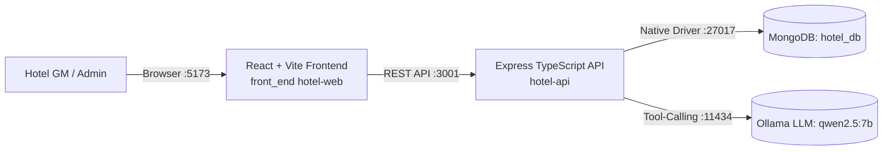

# 🏨 Grand Azur Hotel Management & Analytics System

A full-stack, enterprise hotel management and AI-powered sales analytics platform built with **React 18 + Tailwind CSS + Vite**, an **Express TypeScript Clean Architecture API**, and **MongoDB**.

---

## 🏗️ Architecture Overview



- **Frontend (`front`)**: React 18, TanStack Query v5, Tailwind CSS v4, Lucide icons, responsive dashboard with live KPIs, charts, and AI chat.
- **Backend (`hotel-api`)**: Node.js 22, Express, TypeScript, Clean Architecture (Controllers, Services, Repositories, Models), safe Zod-validated tool-calling engine.
- **Database (`MongoDB hotel_db`)**: Migrated from SQLite (`hotel.db`) with 88,000+ records and performance indexes.
- **AI Agent**: Ollama local LLM running `qwen2.5:7b` with 6 analytical tools executing pre-compiled MongoDB aggregations.

---

## 📁 Project Structure

```
project mullti/
├── front/                     # ⚛️ React 18 + Vite + Tailwind Frontend
│   ├── src/
│   │   ├── components/        # UI Cards, Charts, Donut, Gauge, Chat, Skeletons
│   │   ├── hooks/             # TanStack useDashboard, animations
│   │   ├── api.ts             # Typed fetch client with timeout & error handling
│   │   └── types.ts           # Shared TypeScript models
│   ├── .env                   # VITE_API_URL=http://localhost:3001
│   └── package.json
│
├── hotel-api/                 # 🚀 Node.js + Express Clean Architecture API
│   ├── src/
│   │   ├── config/            # Zod-validated environment config
│   │   ├── database/          # Resilient MongoDB pool & collection bindings
│   │   ├── models/            # Entity models (reservations, KPIs, chat, tools)
│   │   ├── repositories/      # Data access layer & aggregation queries
│   │   ├── services/          # DashboardService, ChatService, ToolRegistry
│   │   ├── controllers/       # HTTP handlers (Health, Dashboard, Chat)
│   │   ├── middlewares/       # Error handling, request logger, CORS
│   │   └── routes/            # Express routers (/api/health, /api/dashboard, /api/chat)
│   ├── .env                   # PORT=3001, DB_NAME=hotel_db, CORS_ORIGIN=*
│   ├── API_DOCUMENTATION.md   # 📖 Comprehensive API reference & schemas
│   └── Dockerfile             # Multi-stage production container
│
├── data base/                 # 💾 Database source & migration scripts
│   ├── hotel.db               # Original SQLite database
│   ├── generate_hotel_db.py   # Deterministic database generator
│   └── load_hotel_api_db.js   # High-speed MongoDB loader
│
├── mongo_exports/             # 📂 Studio 3T JSON/NDJSON export files
│
├── package.json               # Root convenience runner scripts
└── README.md
```

---

## 🚀 Quick Start (Running Backend & Frontend)

### ⚡ Option A: 1-Click Launcher (Windows)

Simply double-click **`start.bat`** in the project root!
It will:
1. Verify Node.js and dependencies
2. Build the backend if needed
3. Launch the Express API (`:3001`) and Vite Frontend (`:5173`) in dedicated windows
4. Automatically open your browser to **http://localhost:5173**

To stop all services at once, double-click **`stop.bat`**.

---

### 💻 Option B: Manual Terminal Execution

Open a terminal and run:

```bash
cd hotel-api
npm start
```
*API will run on **http://localhost:3001** and automatically connect to MongoDB `hotel_db`.*

---

### 2. Start the React Frontend (Port 5173)

Open a **second terminal** and run:

```bash
cd front
npm run dev
```

*Frontend will run on **http://localhost:5173** and automatically stream live data and chat responses from `http://localhost:3001`.*

---

### 3. Open in Browser

Go to:
👉 **http://localhost:5173**

You will see:
- Real-time revenue, RevPAR, and Occupancy cards
- Interactive revenue donut by department
- Monthly room vs other revenue bars
- Recent guest reservations
- **"Ask your data ✦"** interactive AI chat card connected directly to your API and database!

---

## 🤖 Optional: Start Ollama for AI Chat

If you want the AI to answer open-ended questions using its tool-calling engine:

1. Ensure Ollama is running:
   ```bash
   ollama serve
   ```
2. Pull the recommended tool-calling model:
   ```bash
   ollama pull qwen2.5:7b
   ```

*(If Ollama is not started, the frontend gracefully informs the user without crashing).*

---

## 📖 API Documentation
For complete details on request/response schemas, tool definitions, and curl commands, see:
👉 [**`hotel-api/API_DOCUMENTATION.md`**](file:///c:/Users/LOQ/Desktop/project%20mullti/hotel-api/API_DOCUMENTATION.md)
