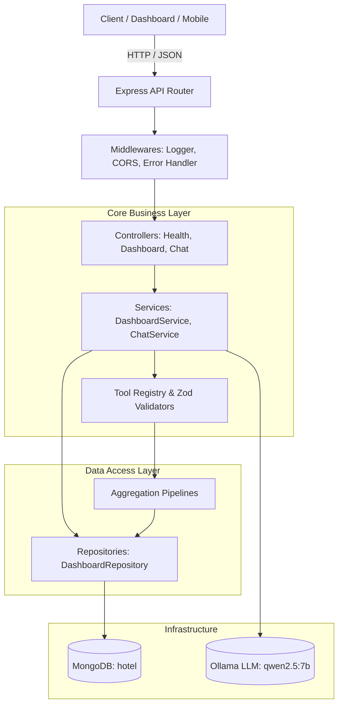

# 🏨 Grand Azur Hotel API — Clean Architecture & API Documentation

> Production-ready RESTful API and AI Tool-Calling Agent for hotel management, sales analytics, and KPI forecasting.

---

## 🏛️ System Architecture

The API is engineered using **Clean Architecture** principles, strictly separating concerns across layers. This guarantees type safety, maintainability, testability, and resilience against external dependency outages.



### 📁 Clean Architecture Directory Structure

```
hotel-api/
├── src/
│   ├── config/                     # Typed configuration & Zod environment validation
│   │   ├── env.ts                  # Zod validation for process.env
│   │   └── index.ts                # Application configuration singleton
│   ├── database/                   # Database lifecycle & connection management
│   │   ├── collections.ts          # Strongly typed collection names
│   │   └── connection.ts           # Resilient Mongo connection pool with auto-fallback
│   ├── models/                     # Domain entity & DTO type definitions
│   │   ├── chat.model.ts           # Chat schemas, messages, and responses
│   │   ├── dashboard.model.ts      # Complete dashboard payload models
│   │   ├── kpi.model.ts            # Daily/Monthly KPI & date range types
│   │   └── reservation.model.ts    # Reservation, guest, room, charge domain models
│   ├── repositories/               # Data access layer (pure DB & aggregations)
│   │   └── dashboard.repository.ts # MongoDB query orchestration
│   ├── services/                   # Business domain logic
│   │   ├── dashboard.service.ts    # KPI computation, YoY/MoM percentage logic
│   │   ├── chat.service.ts         # Ollama LLM conversation loop & tool execution
│   │   └── tools/                  # Analytical tools subsystem
│   │       ├── tool.types.ts       # Tool contracts and execution context
│   │       └── tool.registry.ts    # Tool definitions, schemas, and implementations
│   ├── controllers/                # HTTP request/response handlers
│   │   ├── health.controller.ts    # GET /api/health
│   │   ├── dashboard.controller.ts # GET /api/dashboard
│   │   └── chat.controller.ts      # POST /api/chat
│   ├── middlewares/                # Cross-cutting concerns
│   │   ├── error.middleware.ts     # Centralized error handler with Ollama/Mongo guards
│   │   └── logger.middleware.ts    # Colorized request timing logger
│   ├── routes/                     # Modular route declarations
│   │   ├── health.routes.ts
│   │   ├── dashboard.routes.ts
│   │   ├── chat.routes.ts
│   │   └── index.ts                # Main API route aggregator (/api)
│   ├── pipelines.ts                # Pure MongoDB aggregation pipeline builders
│   ├── app.ts                      # Express application factory
│   └── server.ts                   # Process bootstrap and graceful termination hooks
├── scripts/
│   └── check-pipelines.ts          # Offline in-memory test suite
├── Dockerfile                      # Multi-stage production container build
├── package.json
└── tsconfig.json
```

---

## 🌐 API Endpoints Reference

Base URL: `http://localhost:3001/api`

### 1. Health Check

Verifies server liveness, MongoDB connection status, configured AI model, and data vintage.

- **URL**: `/health`
- **Method**: `GET`
- **Auth**: None
- **Headers**: `Accept: application/json`

#### Response (`200 OK`):
```json
{
  "status": "healthy",
  "ok": true,
  "database": {
    "connected": true,
    "name": "hotel"
  },
  "dataAsOf": "2026-10-17",
  "aiModel": {
    "host": "http://localhost:11434",
    "name": "qwen2.5:7b"
  },
  "uptimeSeconds": 142,
  "timestamp": "2026-10-19T02:30:00.000Z"
}
```

#### cURL:
```bash
curl -X GET http://localhost:3001/api/health
```

---

### 2. Dashboard Aggregate Data

Fetches all key performance indicators, revenue distributions, monthly splits, occupancy trends, channel metrics, and recent reservations in a single performant call.

- **URL**: `/dashboard`
- **Method**: `GET`
- **Auth**: None

#### Response (`200 OK`):
```json
{
  "period": "Jan 2026 – Oct 2026",
  "asof": "Oct 17, 2026",
  "rev": 7974381.47,
  "yoy": 33.6,
  "revpar": 220.91,
  "revparYoy": -0.7,
  "last": {
    "label": "Sep 2026",
    "total": 993268.20,
    "mom": -21.9,
    "occ": 75.3,
    "adr": 370.57,
    "revpar": 278.95
  },
  "months": [
    { "m": "Feb", "room": 158157.00, "other": 298867.86 },
    { "m": "Mar", "room": 239183.00, "other": 396450.97 },
    { "m": "Apr", "room": 331113.00, "other": 459887.64 },
    { "m": "May", "room": 380021.00, "other": 433826.74 },
    { "m": "Jun", "room": 488439.00, "other": 451917.70 },
    { "m": "Jul", "room": 649012.00, "other": 496039.54 },
    { "m": "Aug", "room": 735330.00, "other": 536939.63 },
    { "m": "Sep", "room": 504218.00, "other": 489050.20 },
    { "m": "Oct", "room": 203332.00, "other": 263950.55 }
  ],
  "dept": [
    ["Rooms", 3854973.00],
    ["Food & Beverage", 2210596.74],
    ["Events & Meetings", 1177880.64],
    ["Spa & Wellness", 402005.00],
    ["Transport", 168970.69],
    ["Minibar & Extras", 159955.40]
  ],
  "res": [
    { "n": "Charlotte Willems", "t": "Junior Suite", "ci": "10-15", "co": "10-17", "v": 702.0, "s": "Completed" },
    { "n": "Antoine Bernard", "t": "Deluxe Sea View", "ci": "10-10", "co": "10-17", "v": 2030.0, "s": "Completed" },
    { "n": "Julia Schneider", "t": "Executive Suite", "ci": "10-14", "co": "10-17", "v": 1506.0, "s": "Completed" },
    { "n": "Eline Maes", "t": "Deluxe Sea View", "ci": "10-17", "co": "10-22", "v": 1210.0, "s": "In-house" },
    { "n": "Hugo Dubois", "t": "Classic Deluxe", "ci": "10-17", "co": "10-19", "v": 418.0, "s": "In-house" }
  ],
  "occ": [58.3, 56.7, 63.3, 68.3, 63.3, 58.3, 63.3, 58.3, 60.0, 70.0, 63.3, 70.0, 66.7, 60.0],
  "ch": [
    ["Direct Website", 2042754.00, 359.96, 8.1],
    ["Booking.com", 1616118.00, 354.49, 19.2],
    ["Travel Agency", 1048884.00, 316.41, 7.5],
    ["Expedia", 845149.00, 357.05, 16.8],
    ["Corporate", 745103.00, 307.39, 7.5],
    ["Phone / Email", 675526.00, 367.93, 6.8],
    ["Tour Operator", 662170.00, 267.54, 5.8],
    ["Meetings & Events", 431946.00, 293.24, 2.2],
    ["Walk-in", 333839.00, 402.70, 0.0]
  ],
  "guests": [
    ["Mariem Gharbi", 38862.10, 12],
    ["Abdullah Al-Harbi", 31993.80, 6],
    ["Emily Wilson", 29719.50, 6]
  ]
}
```

#### cURL:
```bash
curl -X GET http://localhost:3001/api/dashboard
```

---

### 3. AI Chatbot (Tool Calling)

Executes a conversation turn with the Grand Azur AI Sales Analyst. The assistant interprets natural language, decides which analytical tools to invoke, runs predefined MongoDB aggregations, and provides a clear executive summary.

- **URL**: `/chat`
- **Method**: `POST`
- **Headers**: `Content-Type: application/json`

#### Request Body:
| Field | Type | Required | Description |
| :--- | :--- | :--- | :--- |
| `messages` | `Array<Message>` | Yes | Array of 1 to 20 past conversation messages. |
| `messages[].role` | `string` | Yes | Either `"user"` or `"assistant"`. |
| `messages[].content`| `string` | Yes | 1 to 2,000 characters. |

```json
{
  "messages": [
    {
      "role": "user",
      "content": "Which booking channel had the highest cancellation rate this year?"
    }
  ]
}
```

#### Response (`200 OK`):
```json
{
  "answer": "This year, Booking.com had the highest cancellation rate at 19.2%, followed by Expedia at 16.8%. Direct Website bookings maintained a much lower cancellation rate of 8.1%.",
  "toolCalls": [
    {
      "name": "revenue_by_channel",
      "args": {
        "from": "2026-01-01",
        "to": "2026-10-17"
      }
    }
  ]
}
```

#### Error Responses:
- **`400 Bad Request`**: Malformed payload or validation error.
- **`503 Service Unavailable`**: Ollama is offline or the required model (`qwen2.5:7b`) is missing.

#### cURL:
```bash
curl -X POST http://localhost:3001/api/chat \
  -H "Content-Type: application/json" \
  -d '{"messages":[{"role":"user","content":"How did RevPAR perform in September 2026?"}]}'
```

---

## 🤖 AI Tool-Calling Engine (Safe & Injection-Proof)

The AI assistant never generates or executes raw database queries. It uses a **deterministic function-calling architecture**:

1. **User asks question** ➔ Sent to Ollama with a curated tool catalog.
2. **Model chooses tool & arguments** ➔ Returns a structured `tool_calls` request.
3. **Backend validates arguments** ➔ Validated with **Zod** (types, date ranges, limits).
4. **Pre-compiled pipeline runs** ➔ Executes pre-tested MongoDB aggregation pipeline.
5. **Results fed back to model** ➔ Model synthesizes the plain-language response.

### Available Analytical Tools

| Tool Name | Parameters | Purpose |
| :--- | :--- | :--- |
| **`get_kpis`** | `from?: string`, `to?: string` | Calculates total rooms sold, rooms available, room revenue, Occupancy %, ADR (€), and RevPAR (€) over a date range. |
| **`get_monthly_kpis`** | `year?: number` | Provides a 12-month breakdown of monthly Occupancy, ADR, RevPAR, and room revenue for a specified year. |
| **`revenue_by_department`** | `from?: string`, `to?: string` | Computes revenue by department (Rooms, F&B, Events, Spa, Transport, Minibar) from folio charges. |
| **`revenue_by_channel`** | `from?: string`, `to?: string` | Compares booking channels: volume, cancellation %, room nights, room revenue, and ADR. |
| **`top_guests`** | `from?: string`, `to?: string`, `limit?: number` | Identifies top-spending guests, their total spend, and number of realized stays. |
| **`guests_by_nationality`**| `from?: string`, `to?: string`, `limit?: number` | Aggregates volume and spending by guest country of origin. |

---

## 🗄️ MongoDB Database Schema Reference

The API queries the **`hotel`** (or `hotel_db`) database:

### 1. `reservations`
Primary collection containing stays, guest profiles, room allocations, booking channels, and embedded charges:
```typescript
interface Reservation {
  _id: number;
  confirmationCode: string;
  guestId: number;
  guestName: string;
  guestNationality: string;
  room: { id: number; number: string; type: string };
  channel: { id: number; name: string; type: string };
  bookingDate: Date;
  checkIn: Date;
  checkOut: Date;
  nights: number;
  ratePerNight: number;
  status: 'Checked-out' | 'In-house' | 'Confirmed' | 'Cancelled' | 'No-show';
  totalCharges: number;
  charges: Array<{
    chargeId: number;
    department: string;
    date: Date;
    description: string;
    amount: number;
  }>;
}
```

### 2. `daily_kpis`
Pre-aggregated daily metrics used for high-speed range queries:
```typescript
interface DailyKpi {
  _id: string; // "2026-10-17"
  date: Date;
  roomsSold: number;
  roomsAvailable: number;
  roomRevenue: number;
  occupancyPct: number;
  adr: number;
  revpar: number;
}
```

### 3. `monthly_kpis`
Summary by month used for MoM tracking and yearly overviews:
```typescript
interface MonthlyKpi {
  _id: string; // "2026-09"
  year: number;
  month: number;
  roomsSold: number;
  roomsAvailable: number;
  occupancyPct: number;
  roomRevenue: number;
  adr: number;
  revpar: number;
}
```

### 4. `department_revenue_monthly`
Monthly revenue breakdown per department:
```typescript
interface DepartmentRevenueMonthly {
  yearMonth: string; // "2026-09"
  department: string; // "Food & Beverage"
  revenue: number;
}
```

---

## ⚙️ Configuration & Environment Variables

Configure via `hotel-api/.env`:

| Variable | Default | Description |
| :--- | :--- | :--- |
| `PORT` | `3001` | HTTP server listening port |
| `MONGO_URI` | `mongodb://localhost:27017` | MongoDB connection string |
| `DB_NAME` | `hotel` | Database name (auto-detects `hotel_db` if available) |
| `OLLAMA_HOST` | `http://localhost:11434` | Ollama instance endpoint |
| `OLLAMA_MODEL` | `qwen2.5:7b` | LLM model for tool calling (`qwen2.5:7b` recommended) |
| `CORS_ORIGIN` | `*` | Allowed CORS origins (comma-separated or `*`) |

---

## 🚀 Running the API

### 1. Development Mode (Live reload)
```bash
cd hotel-api
npm install
npm run dev
```

### 2. Build and Production Run
```bash
npm run build
npm start
```

### 3. Run Pipeline Offline Test
Runs all 6 tools against data using an in-memory emulator without needing MongoDB or Ollama:
```bash
npm run check
```

### 4. Docker Deployment
```bash
# Build the image
docker build -t hotel-api .

# Run container
docker run -p 3001:3001 --env-file .env hotel-api
```
